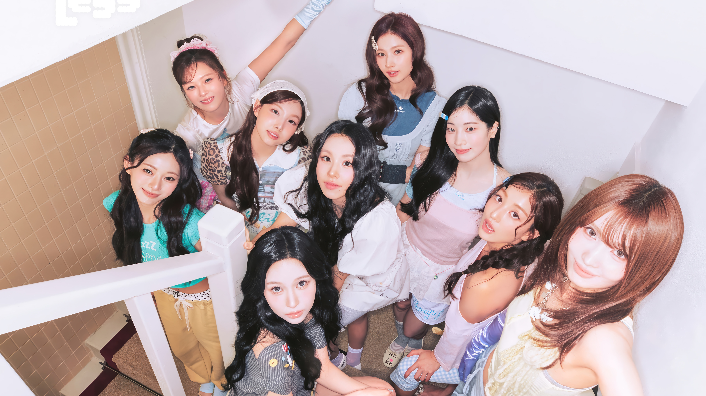
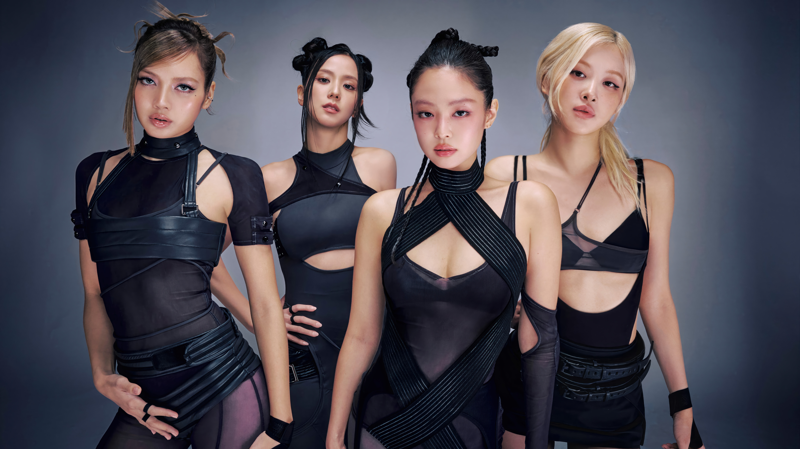

<div align="center">


<a href="https://github.com/SrCalvo">
  
</a>

<br/>


</div>

<br/>

## `$ whoami`

<div align="center">
  
</div>

<br/>

## `$ cat tech-stack.yaml`

```yaml
frontend:   [HTML, CSS, SCSS, JavaScript, TypeScript, React, Angular]
backend:    [PHP, Laravel, Node.js, npm/npx, Laragon]
languages:  [C, C++, Python]
database:   [MySQL]
systems:    [Arch Linux, Fedora, Bash]
tools:      [Git, GitHub, VS Code]
status:     building
env:        local_dev
```

<div align="center">
  
</div>

<br/>

## `$ cat github_stats.json`

<div align="center">


<br/>


</div>

<br/>

## `$ cat learning.md`

```text
[x] Diseño de software multiplataforma  → arquitecturas limpias y reutilizables
[~] React   (intermedio → avanzado)
[~] Angular (intermedio → avanzado)
[~] Laravel & PHP                       → backend robusto y APIs
[~] Python                              → scripting, automatización, backend ligero
[~] SCSS / arquitectura CSS             → diseño mantenible a escala
```

## `$ cat foss.md`

Promotor activo de la filosofía **FOSS**: transparencia, soberanía tecnológica y colaboración abierta.
Uso diario **Arch Linux** y **Fedora**, con **Hyprland** como window manager en Wayland.

## `$ locale`

| 🇪🇸 Español | 🇺🇸 English | 🇧🇷 Português |
| :---: | :---: | :---: |
| Nativo | Básico técnico | Básico |

<br/>

## ✨ My Lovelys

<div align="center">

| TWICE | BLACKPINK |
| :---: | :---: |
|  |  |
|  |  |


</div>

<br/>

## `$ connect --socials`

<div align="center">

<a href="mailto:j.jazael11@hotmail.com"></a>
<a href="https://www.instagram.com/jazael_ontanon"></a>
<a href="https://youtube.com/@srcalvojazaelontanon115"></a>
<a href="https://www.facebook.com/JazaelMC"></a>

<br/><br/>

<sub>Hecho en México 🇲🇽 · <b>@SrCalvo</b></sub>


</div>
